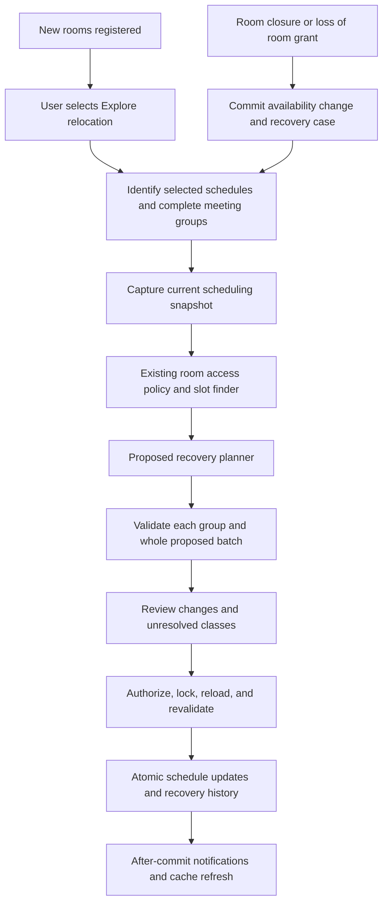

# Dynamic Room Reassignment and Schedule Recovery

Status: Proposed architecture and implementation plan; no application behavior changed.
Prepared: 2026-10-20.
Basis: Supplied panel-discussion interpretation and targeted inspection of the current working checkout.

## 1. Recommendation and scope

Extend WICARS's Recommendation Module with **Dynamic Room Reassignment and Schedule Recovery**. When a room becomes unavailable or a department loses permission to use it, identify affected classes and recommend the smallest feasible set of changes. When new rooms are registered, offer an explicit relocation preview.

The system automates impact analysis, alternative search, and validation. Authorized people retain control over applying schedule changes.

Use a deterministic constraint-based approach within the existing Laravel application and React interface. A new microservice, machine-learning model, or full timetable regeneration is unnecessary for this requirement.

### Proposed first release

- Immediate, indefinite room closure and explicit reopening.
- Loss of an approved borrowing grant.
- Same-timeslot room replacement for existing editable schedules.
- Optional alternative-time search, explicitly enabled by the user.
- Group validation, review, stale-preview rejection, atomic application, and history.
- User-triggered exploration of newly registered rooms, using existing building metadata.

Preserve instructor, course, section, ownership, contact hours, delivery mode, meeting pattern, and unaffected placements. Do not silently split sessions, convert classes online, change instructors, move unrelated classes, or relax hard rules.

Date-specific repairs, scheduled future closures, building administration, equipment inventories, and cascading moves of unaffected classes are later extensions. They require additional requirements and data support.

## 2. Verified foundations and integration gaps

Paths below are relative to the repository. These findings describe the inspected working tree, including its existing uncommitted changes.

| Area | Verified implementation | Integration implication |
|---|---|---|
| Room records | `backend/app/Models/Rooms.php` contains building, type, status, department, and home-program behavior | Extend existing room management; do not create a second room inventory |
| Structural edits | `backend/app/Services/RoomStructuralUpdate.php` locks affected semester scopes, updates transactionally, and rejects changes invalidating scheduled classes | An explicit closure operation is needed; ordinary room edits must retain their protection |
| Availability | `RoomAvailabilityRule` rejects rooms whose status is not `available` | Reuse this rule and ensure matching snapshot/kernel/search behavior |
| Cross-department access | `RoomAccessPolicy` handles approved grants, semester-specific windows, reachable rooms, and lent windows | Physical vacancy alone never grants permission to borrow |
| Lost borrowing access | `RoomRequestController::releaseDependentSchedules` clears affected room assignments when a grant closes | Capture affected IDs and old room data before this happens; integrate recovery with this flow |
| Existing recommendations | `RecommendationEngine`, `ConflictRecommendationProvider`, and `ConflictRecommender` provide placement suggestions | Reuse candidate generation and result conventions; current per-conflict options are not a room-wide recovery plan |
| Candidate search | `AvailableSlotFinder` and `SchedulingSnapshotRepository` | Search from consistent snapshots and existing placement rules |
| Complete meeting groups | `PlacementGroupValidator` checks a single complete course/section meeting group with tentative occupancy | Validate each group against the other proposed groups; do not pass unrelated classes as one meeting group |
| Batch conflicts | `BatchConflictValidator` checks pairwise batch conflicts | Combine batch checks with persisted-state, row, and group validation |
| Edit eligibility | `SameTimePartnerMover::EDITABLE_STATUSES` contains `draft`, `completed`, and `revision` | Reuse authoritative eligibility; approved/submitted rows need the existing revision workflow |
| Persistence | `ScheduleController` has semester-lock and transaction-based batch writes | Reuse this verified write boundary or extract its shared logic narrowly |
| Locks | `DatabaseSchedulingScopeLock` acquires sorted semester advisory locks on MySQL/MariaDB | Coordinate every competing room, grant, and schedule writer |
| UI | Shared Rooms, RoomRequests, and SchedulerPanel already exist | Add recovery actions and a reusable review panel within existing screens |

### Documentation discrepancy to resolve

`docs/architecture.md` describes `CommitSchedulePlan` and related adoption. Targeted file and PHP searches did not locate that service in this checkout; the inspected controllers use other paths. Do not implement against that documented name without locating its actual runtime implementation. Phase 0 must reconcile the documentation with the active checkout and routes.

The room-request implementation plan also describes locking and integrity improvements that must not be assumed complete. The inspected grant controller uses database transactions, while the shared semester lock is not visible there. Verify and complete shared-lock coverage before connecting recovery to grant changes.

Room capacity and equipment fields were not found in the inspected room model/create request. Do not claim those constraints are enforced. First use existing room-type and course rules; add capacity/equipment requirements only with explicit schema, validated source data, and parity across validators.

## 3. Architecture

### Proposed responsibilities

These names are design proposals, not existing classes or API contracts.

| Component | Responsibility |
|---|---|
| `RoomRecoveryService` | Orchestrate incident creation, impact analysis, preview, and application |
| `RecoveryImpactAnalyzer` | Find affected rows and complete linked groups, including borrowers and immutable rows |
| `RoomRecoveryPlanner` | Coordinate candidates across all selected groups, minimize disruption, return bounded-search diagnostics |
| Recovery recommendation adapter | Expose the planner through existing recommendation conventions with accurate evidence scope |
| Recovery persistence adapter | Apply updates through shared schedule-write validation, authorization, locking, history, and cache behavior |
| Reusable React recovery panel | Display affected classes, complete alternatives, differences, unresolved reasons, and Apply state |

Start with a small orchestration service and planner; extract further classes only when responsibilities justify them. Keep constraints in existing scheduling services.

The planner may calculate feasible candidates beyond a requesting user's editable scope internally, but responses must honor existing schedule visibility. A department user cannot apply another department's changes. Partition application by authorized ownership scope, with fresh global occupancy checks on every commit.

## 4. Workflow A: room closure or lost access

1. An authorized room manager selects **Mark unavailable and assess impact**, supplies a reason, and reviews the impact count.
2. Under coordinated locks, persist the unavailable status and a recovery case. Capture affected schedule identities, old assignments, ownership, term, and linked groups.
3. Keep unresolved schedules visible with a recovery warning. Their existing room reference is historical assignment data, not evidence the class can still use the room.
4. Block new placements in the closed room immediately. Do not wait for a successful replacement search.
5. Notify affected owners after commit. Each owner opens the case and selects eligible groups.
6. Search replacement rooms at existing times. Exclude the closed room and rooms without current access.
7. If required, the user enables **Allow time changes** and runs a wider search.
8. Display one or more complete plans, unresolved groups, required approvals, and explanations.
9. Apply an explicitly selected validated plan atomically. Keep unresolved groups open for later recovery.

**Important distinction:** closing a room is a real availability change; applying replacements is a separate reviewed operation. Closing must remain possible even when no replacement exists.

Do not globally disable `RoomStructuralUpdate` validation. Add a dedicated, authorized closure path that records affected rows and recovery state. Keep ordinary department/type/status edits protected.

For grant revocation/return, preserve the current release-to-Room-TBA behavior and approval status. Capture source assignments before clearing `room_id`, then create the recovery case in the same transaction. This plan does not broaden manual Room-TBA eligibility.

### Approved and submitted schedules

Detect all affected rows regardless of edit eligibility. Mark approval-protected rows as requiring the existing revision/reopening process. Do not apply a recovery proposal or automatically reset approval status for those rows. Recompute the proposal after the authorized revision transition.

### Planned versus immediate changes

A planned administrative reassignment can preview replacements before taking effect. An immediate physical closure must block use immediately. Do not represent a future effective date with the current global room-status field; future and date-limited availability need a separate supported model.

## 5. Workflow B: new room or building capacity

1. Register rooms through existing room management, including building, room type, ownership, and availability.
2. Registration does not move any class.
3. Offer **Explore relocation to these rooms**. Require an explicit semester and selected department/section or existing recovery case.
4. Prioritize unresolved recovery cases; otherwise evaluate only selected existing classes.
5. Check current permissions and suitability before generating options.
6. Show before/after comparisons and the concrete benefit, such as resolving an unavailable-room assignment or reducing changed class times in a pending recovery plan.
7. Apply only the selected plan after current validation.

A newly opened building is initially a set of room records sharing building metadata. A dedicated buildings table is unnecessary unless building-level administration becomes a separate requirement.

For valid, unaffected schedules, leave them in place by default. A new room alone is not evidence that relocating them improves the timetable.

## 6. Search and ranking strategy

### Hard constraints

Every proposal must preserve:

- Room, instructor, and section non-overlap against all relevant persisted schedules and other proposed moves.
- Existing room-type and laboratory rules, including lecture-use restrictions.
- Department/program room allocation and approved borrowing windows.
- Instructor availability, operating hours, permitted/required days, and applicable time-grid rules.
- Complete split/integrated/consecutive group invariants and contact hours.
- Existing delivery mode, instructor assignments, schedule ownership, and approval restrictions.

The current conflict recommender excludes some meeting types, including consecutive runs. The first release must explicitly label unsupported groups for manual handling, or add validated support before advertising full coverage.

### Search order

1. Build candidates at each group's original day and time using authorized rooms.
2. Solve assignments jointly across groups. A first-fit loop can consume the only suitable room for a laboratory.
3. Process the most constrained groups first, then use bounded backtracking with tentative occupancy and deterministic tie-breaking.
4. If enabled, add alternate times while respecting existing group patterns and rules.
5. Validate each complete group against all other proposed groups and unchanged persisted occupancy, then perform batch checks.

Use existing candidate/search primitives where their contracts fit. Add a restricted recovery search rather than invoking full year-level regeneration.

For full previews, ignore only the exact persisted rows actually replaced, and include all kept partners. For partial application, regenerate/revalidate the selected subset while treating unselected rows as unchanged occupancy. Never remove every impacted row from validation when only some will be changed.

### Ranking, in priority order

1. Recover the greatest number of affected complete groups.
2. Minimize groups with changed days or times.
3. Minimize additional changed rows, including linked partners.
4. Prefer authorized local rooms over borrowing when otherwise equivalent.
5. Use existing placement-quality preferences and deterministic room-ID tie-breaking.

Report counts alongside the ranking. A plan with five same-time moves and two time changes should state exactly that.

Use configurable time/candidate budgets. Distinguish **no eligible rooms**, **permission required**, **approval workflow required**, **unsupported group**, and **search limit reached**. A bounded search with no result is not proof that the problem is impossible.

Borrowing candidates without approved access may appear only as clearly separated request opportunities, subject to visibility rules. They are not applicable recommendations. Use the existing room-request workflow and regenerate after approval.

## 7. Persistence design

Proposed logical records, subject to migration design after auditing existing recommendation/history storage:

| Record | Minimum information | Purpose |
|---|---|---|
| Recovery case | Trigger identity, source room/grant, reason, actor, semester, case state | Durable incident tracking |
| Impacted item | Case, persisted schedule ID, group identity, original assignment, resolution state | Preserve impact even after a grant clears room IDs |
| Recovery plan | Case/scope, creator, policy version, snapshot fingerprint, proposed changes, diagnostics, plan state | Reviewable proposal and stale detection |

Prefer reusing existing persisted recommendation storage if it supports a versioned batch payload, ownership scope, expiry, and atomic application. Otherwise introduce these narrowly scoped records. Do not add a second full schedule table.

Suggested case states: open, partially resolved, resolved, cancelled. Suggested plan states: ready, applied, stale, cancelled. Treat asynchronous execution status separately if queued processing is added.

Enforce trigger idempotency and uniqueness for impacted case/schedule pairs. Store before/after details in existing audit/history conventions. Store a policy version and fingerprints that cover schedule rows, occupancy, room state, grants, and relevant rules; checking only the source rows misses changes in destination availability.

The first release uses immediate indefinite unavailability. Date-specific closures require occurrence-aware validation and persistence because current recurring weekday schedules cannot express a one-week relocation safely.

## 8. Apply protocol and concurrency

1. Authenticate and authorize the actor against current capabilities, persisted ownership/program scope, and workflow status.
2. Accept a stored plan identity and selection, not unrestricted client-authored schedule replacements.
3. Acquire the established semester locks in sorted order; coordinate shared room/grant row locks with every writer.
4. Within a database transaction, lock the plan and affected rows, reload room/grant/rule state, and verify the plan has not already been applied.
5. Reject stale plans and return a refresh action. Revalidate current rules even when fingerprints match.
6. Validate the final selected batch against current unchanged occupancy and complete linked groups.
7. Update existing rows in place; preserve schedule IDs, ownership, instructor, and approval policy.
8. Persist history and plan/case state in the same transaction. Any failure rolls back the selected batch.
9. Dispatch notifications and invalidate caches after commit. Notification delivery failure must not misreport a committed batch as unsaved.

A selected batch is all-or-nothing. Partial recovery means a user explicitly applies a verified subset, not that the server silently saves successful rows from a failing batch.

Preview is not a reservation. Two users may see the same destination; application must serialize and reject the stale second plan.

Closure must also coordinate with writers creating a new placement or grant in another semester. Do not derive the entire lock scope solely from current source-room schedules and assume this covers future concurrent writers. Audit room row locking and semester-first ordering across all affected paths; recheck discovered scope before committing.

Test actual contention using MySQL/MariaDB. The existing advisory-lock implementation does not exercise those locks on SQLite.

## 9. UI and API contracts

### Interface

- Rooms: closure/reopening actions, affected-class count, and open recovery indicator.
- Room Requests: recovery link after return/revocation, using captured impacted rows.
- SchedulerPanel: persistent room-availability warning and **Review recovery** action.
- Recovery panel: scope selector, preserve-time default, optional time changes, complete plan selector, differences, unresolved reasons, and Apply.
- New rooms: **Explore relocation**, with explicit scope and no automatic schedule mutation.

Show course, section, instructor, original room/time, proposed room/time, explanation, and approval requirement. Distinguish affected schedules from meeting groups so split classes are not misleadingly double-counted.

Include loading, empty, failed, partial-result, stale, permission-required, approval-required, and applied states. Changing scope or manually altering plan choices invalidates the displayed validation until checked again.

### Proposed operations

Final route names must follow existing API conventions:

| Operation | Server behavior |
|---|---|
| Record closure/reopening | Authorize room mutation, update availability, record impact; never automatically relocate |
| Read recovery case | Apply existing visibility scopes to affected rows and results |
| Preview recovery | Capture current state, generate complete plans, return diagnostics and fingerprint |
| Preview new-room relocation | Validate explicit scope and selected rooms; no schedule writes |
| Apply selected plan | Require current edit authority, lock/revalidate, update atomically |
| Refresh stale plan | Generate a new proposal without silently applying a changed alternative |

Do not create broad permissions merely to simplify this feature. Map each action to existing capabilities and role-specific workflows first; add a capability through the existing registry only if a genuine authorization gap remains.

## 10. Implementation sequence

| Phase | Deliverable | Completion gate |
|---|---|---|
| 0. Confirm integration contracts | Reconcile runtime/documentation, map active routes and writes, confirm editable/approval stages, supported groups, lock coverage, and panel scope | Written current-state map; no unresolved persistence or authorization assumptions |
| 1. Availability and impact | Dedicated closure operation, durable case/impact records, snapshot exclusion, grant-loss linkage, reopening behavior | Closed rooms are excluded everywhere; affected historical assignments remain visible; concurrency regressions pass |
| 2. Same-time recovery | Candidate reuse, constrained group ordering, joint batch validation, deterministic ranking | Multiple classes cannot claim the same destination; no instructor/time/delivery changes |
| 3. Review and atomic apply | Shared recovery panel, stored proposals, stale rejection, history, idempotency, after-commit refresh | Reviewed batches save fully or not at all; unauthorized/stale changes are rejected |
| 4. Optional alternative times | Opt-in alternate-time search, intact meeting groups, disruption explanations | Duration, instructor availability, patterns, and unchanged occupancy remain valid |
| 5. New-room exploration | Explicit room/scope selection and preview, recovery prioritization | Adding rooms alone never changes schedules |
| 6. Verification and release | Integration/contention tests, manual demonstration, documentation updates, feature-controlled rollout | Acceptance scenarios pass and deployment/rollback procedure is documented |

Phases 1–3 provide the core recovery demonstration. Phases 4–5 complete the two panel scenarios. Estimate implementation effort after Phase 0 identifies schema and write-path changes.

## 11. Acceptance scenarios

| Scenario | Required outcome |
|---|---|
| CIT loses Room 201 containing eight classes | All affected rows/groups are identified; replacements exclude Room 201; unresolved items remain explicit |
| Two overlapping classes compete for one alternative room | No complete plan assigns that room to both |
| A laboratory has one compatible destination | General lectures do not consume it when another jointly feasible assignment exists |
| Another department has a vacant room but no grant | No applicable recommendation until the required borrowing approval exists |
| Borrowing covers only part of the class interval | Destination is rejected |
| A grant is revoked after preview | Apply rejects or refreshes; revoked permission cannot be used |
| Another user books a destination after preview | Stale application makes no schedule changes |
| One affected class belongs to another department | Its owner handles application; visibility and edit scope remain enforced |
| Linked meetings span affected and unaffected rooms | Kept partners remain in validation; meeting invariants are preserved |
| Submitted/approved schedules are impacted | Case is visible; direct reassignment is blocked pending the normal revision workflow |
| Only six of eight classes can be recovered | Explain the two unresolved classes; explicitly selected six-class batch is revalidated and atomic |
| New building is added | Existing schedules stay unchanged until a relocation plan is reviewed and applied |
| Apply is retried after a network timeout | Return the existing outcome; do not duplicate changes/history |
| Database write fails midway | Roll back all selected changes and plan-state updates |
| Search reaches its budget | Report incomplete search, with feasible results only if fully validated |
| Room reopens | Refresh the case and current validity; do not automatically move recovered classes back |

Reuse and extend relevant room-request, room-access, kernel/rule parity, conflict-recommendation, group-validation, and scheduling-write tests. Add UI tests for stale previews, scope changes, disabled Apply, and successful refresh. Exercise competing writes with two database connections.

Measure recovered groups, unresolved reasons, changed-time count, preview latency, search-limit frequency, stale-plan frequency, and rollback failures. Set numeric performance targets after benchmarking representative department data; do not invent a guarantee.

## 12. Rollout and decisions to confirm

Release behind a feature setting with preview-only availability first, then enable reviewed application after concurrency tests pass. Disabling recovery must not reopen closed rooms or erase unresolved cases. Reversing an applied relocation is a new reviewed plan against current conditions, not a blind restoration of old room assignments.

Recommended defaults pending stakeholder confirmation:

1. Preserve times first; allow alternative times only by explicit choice.
2. Support immediate indefinite closures initially; defer date-range repairs.
3. Keep approval-protected schedules on the existing revision path.
4. Permit borrowing only through existing approved access and role restrictions.
5. Leave instructors, delivery modes, and meeting shapes unchanged.
6. Treat capacity/equipment matching as separate requirements unless verified source data exists.

Suggested manuscript description:

> WICARS identifies schedules affected by room availability or access changes and recommends minimally disruptive room or time reassignments. It validates proposed changes collectively against scheduling constraints and room-sharing permissions, presents unresolved cases, and applies authorized selections transactionally after fresh validation.

This is consistent with a conflict-detection and recommendation focus. Acceptance within the approved thesis scope remains a panel decision.
